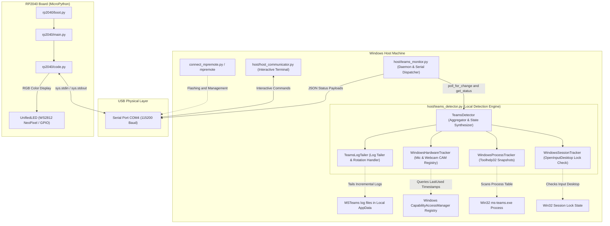
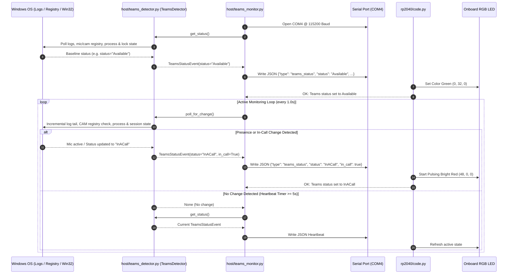
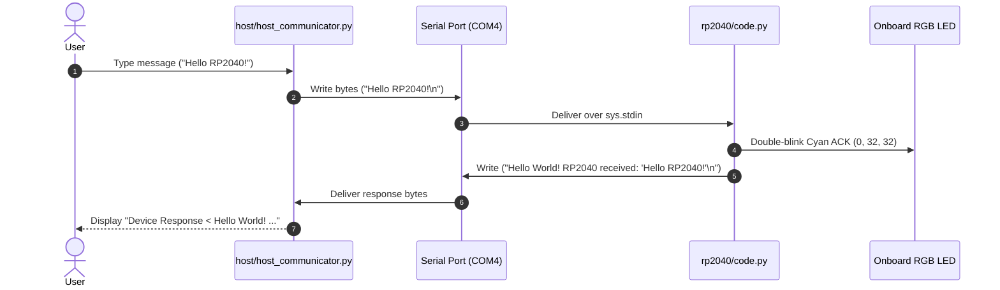

# USB Communicator: RP2040 & Host Serial Interface

This repository provides a complete, robust USB Serial (CDC) communication framework between a Windows Host system and an RP2040 microcontroller running **MicroPython**, featuring a **100% local, zero-network Microsoft Teams Status Monitor & Presence Light**.

---

## Architecture Overview

Communication occurs over a USB CDC serial link operating at **115200 baud rate** (defaulting to **COM4**).



---

## Directory Structure & File Overview

```
USBCommunicator/
├── docs/
│   ├── USB_C_RP2040_LR7843_CIRCUIT_DESIGN.md # Hardware schematic, BOM & simulation guide
│   └── WINDOWS_STARTUP_GUIDE.md              # Auto-start setup & background service guide
├── simulation/
│   ├── usb_rp2040_lr7843.asc                 # Graphical LTspice schematic file
│   ├── usb_rp2040_lr7843.cir                 # SPICE netlist with device models & measurements
│   └── verify_circuit.py                     # Automated LTspice simulation & test suite
├── host/
│   ├── teams_detector.py      # Core 100% local Teams status & hardware detection engine
│   ├── teams_monitor.py       # Standalone Teams monitor CLI & USB serial dispatcher
│   ├── test_teams_detector.py # Automated unit test suite (7 tests)
│   ├── host_communicator.py   # Interactive terminal serial client
│   └── requirements.txt       # Host Python dependencies (pyserial)
├── rp2040/
│   ├── boot.py                # Startup script run once on MicroPython boot
│   ├── main.py                # Main entry point triggering code.py
│   └── code.py                # Non-blocking serial handler, JSON parser & RGB LED control
├── build_exe.py                # PyInstaller standalone executable compiler
├── build_exe.bat               # Batch shortcut to build dist\TeamsMonitor.exe
├── flash_and_deploy_rp2040.py  # Automated BOOTSEL UF2 flasher, port scanner & script deployer
├── connect_mpremote.py         # Python helper to run mpremote with RP2040 port auto-discovery
├── connect_mpremote.bat        # Command Prompt shortcut for mpremote with auto-discovery
├── connect_mpremote.ps1        # PowerShell shortcut for mpremote with auto-discovery
└── CHANGELOG.md                # Version history and release notes
```

---

## `host/` Component Breakdown

### 1. [`host/teams_detector.py`](file:///D:/Git/USBCommunicator/host/teams_detector.py)
Core detection engine that combines multiple local OS signals without external network access:
* **`TeamsLogTailer`**:
  * Auto-discovers the active Microsoft Teams log directory at `%LOCALAPPDATA%\Packages\MSTeams_8wekyb3d8bbwe\LocalCache\Microsoft\MSTeams\Logs`.
  * Incrementally tails `MSTeams_*.log` files by tracking byte offsets to minimize disk I/O.
  * Handles log rollover and rotation when Teams restarts or generates new timestamped log files.
  * Parses `UserPresenceAction` and multi-user `UserDataGlobalState` events to detect presence (`Available`, `Busy`, `DoNotDisturb`, `Away`, `BeRightBack`, `Offline`).
  * Parses `cross_cloud::meetingstore` size markers to detect active meetings.
* **`WindowsHardwareTracker`**:
  * Inspects Windows Registry `HKCU\Software\Microsoft\Windows\CurrentVersion\CapabilityAccessManager\ConsentStore` for `microphone` and `webcam` usage by `MSTeams_8wekyb3d8bbwe`.
  * Provides instant sub-second in-call detection when microphone or camera capture is active.
* **`WindowsProcessTracker`**:
  * Uses native Windows Toolhelp32 API (`ctypes`) to verify if `ms-teams.exe` is running vs closed.
* **`WindowsSessionTracker`**:
  * Checks desktop input session state to detect when the workstation is locked.
* **`TeamsDetector`**:
  * Aggregates all signals into normalized `TeamsStatusEvent` objects and provides `poll_for_change()`.

### 2. [`host/teams_monitor.py`](file:///D:/Git/USBCommunicator/host/teams_monitor.py)
Standalone CLI application and USB serial bridge:
* Runs an event loop checking for status changes and displays ASCII console badges (`[* AVAILABLE]`, `[# BUSY]`, `[! IN A CALL]`, `[- DO NOT DISTURB]`, etc.).
* Transmits newline-terminated JSON payloads to the RP2040 microcontroller over the selected COM port.
* Dispatches periodic keep-alive heartbeats (default every 5 seconds) to ensure microcontroller state stays in sync.
* Supports console-only standalone execution (`-s` / `--standalone`).

### 3. [`host/test_teams_detector.py`](file:///D:/Git/USBCommunicator/host/test_teams_detector.py)
Comprehensive unit test suite verifying:
* Status normalization and mapping.
* Initial log read and incremental tailing from byte offsets.
* Multi-user global state log parsing.
* Log file rotation handling.
* JSON serialization format.
* State aggregation logic under mocked process, session, and hardware states.

### 4. [`host/host_communicator.py`](file:///D:/Git/USBCommunicator/host/host_communicator.py)
Interactive terminal client for manual serial testing, port discovery, and raw message sending.

---

## `rp2040/` Component Breakdown (MicroPython Board)

### 1. [`rp2040/boot.py`](file:///D:/Git/USBCommunicator/rp2040/boot.py)
Runs once on hardware reset / power-on before `main.py`. Performs clean garbage collection.

### 2. [`rp2040/main.py`](file:///D:/Git/USBCommunicator/rp2040/main.py)
Auto-started entry point that executes `code.py`.

### 3. [`rp2040/code.py`](file:///D:/Git/USBCommunicator/rp2040/code.py)
* **Non-blocking Polling**: Uses `select.poll()` on `sys.stdin` with zero timeout (`poll(0)`).
* **Hardware Abstraction (`UnifiedLED`)**: Automatically detects WS2812 NeoPixels (on board definition or GPIO 16, e.g. Waveshare RP2040-Zero/Matrix) or standard GPIO LEDs (Raspberry Pi Pico pin `"LED"`, GPIO 25, or GPIO 13).
* **JSON Payload Handling**: Automatically parses incoming Teams status JSON payloads, updates internal state, and adjusts LED colors.
* **Plain-Text Compatibility**: Responds to plain-text messages with greeting strings and double-blinks cyan ACK.

---

## Communication Protocols

### 1. Teams Status JSON Protocol (Automated Monitor)
Transmitted over serial by `teams_monitor.py` on state change or heartbeat:
```json
{
  "type": "teams_status",
  "status": "Available",
  "availability": "Available",
  "in_call": false,
  "in_meeting": false,
  "mic_active": false,
  "camera_active": false,
  "is_running": true,
  "is_locked": false,
  "timestamp": "2026-08-19T12:19:43.048989-05:00"
}
```

Microcontroller response:
```
OK: Teams status set to Available
```

### 2. RP2040 LED Color Mapping

| Status | LED Color | RGB Value | Behavior |
| :--- | :--- | :--- | :--- |
| **Available** | Gentle Green | `(0, 32, 0)` | Solid |
| **Busy** | Red | `(32, 0, 0)` | Solid |
| **In A Call / In A Meeting** | Bright Red | `(48, 0, 0)` | Pulsing animation (600ms cycle) |
| **Do Not Disturb** | Magenta / Purple | `(32, 0, 32)` | Solid |
| **Away / Be Right Back** | Amber / Yellow | `(32, 20, 0)` | Solid |
| **Offline / Not Running** | Off | `(0, 0, 0)` | Faint 20ms blip every 3s (heartbeat) |
| **Unknown** | Dim Cyan | `(0, 16, 32)` | Solid |

---

## Sequence Diagrams

### Teams Status Monitoring Sequence


### Interactive Serial Terminal Sequence


---

## Quick Start Guide

### 1. Install Host Dependencies
```powershell
pip install -r host/requirements.txt
```

### 2. Provision & Upload Code to the RP2040 Board

#### Option A: Automated One-Step Provisioning & Deployment (Recommended)
Whether your RP2040 is brand new in factory **BOOTSEL mode** (mounted as a removable drive `RPI-RP2` with no COM port yet) or already running MicroPython, run [`flash_and_deploy_rp2040.py`](file:///D:/Git/USBCommunicator/flash_and_deploy_rp2040.py):
```powershell
python flash_and_deploy_rp2040.py
```
What this script does automatically:
1. **Detects BOOTSEL Drive (`RPI-RP2`)**: If the board is in UF2 bootloader mode, it downloads the latest official MicroPython `.uf2` firmware for the **Waveshare RP2040-Zero** (or `--board pico` / custom `--uf2 <path>`), flashes it to the `RPI-RP2` drive, and waits for the board to reboot.
2. **Auto-Discovers the COM Port**: Scans active USB serial devices for RP2040 hardware Vendor IDs (`0x2E8A`, `0x239A`, `0x1B4F`)—no need to guess whether Windows assigned `COM3` or `COM4`.
3. **Deploys Scripts via `mpremote`**: Copies [`rp2040/boot.py`](file:///D:/Git/USBCommunicator/rp2040/boot.py), [`rp2040/code.py`](file:///D:/Git/USBCommunicator/rp2040/code.py), and [`rp2040/main.py`](file:///D:/Git/USBCommunicator/rp2040/main.py) to the board's root filesystem, verifies `fs ls`, and soft-resets the microcontroller.
4. **Verifies Live Serial Link**: Sends a `ping` at `115200` baud and confirms the `Hello World! RP2040 received: 'ping'` response.

#### Option B: Manual `mpremote` File Upload
[`connect_mpremote.py`](file:///D:/Git/USBCommunicator/connect_mpremote.py) automatically discovers the connected RP2040 COM port (or accepts an explicit `connect COMx`):
```powershell
python connect_mpremote.py cp rp2040/boot.py :boot.py
python connect_mpremote.py cp rp2040/code.py :code.py
python connect_mpremote.py cp rp2040/main.py :main.py
python connect_mpremote.py reset
```

### 3. Run the Standalone Teams Status Monitor
Run in full mode (monitors Teams and auto-discovers the RP2040 COM port, or pass `--port COM3` / `--port COM4`):
```powershell
python host/teams_monitor.py
```

Or run in console-only standalone mode (without serial connection):
```powershell
python host/teams_monitor.py --standalone
```

#### CLI Options for `teams_monitor.py` / `TeamsMonitor.exe`
| Argument | Description | Default |
| :--- | :--- | :--- |
| `-p`, `--port` | Target USB Serial COM port, or `'auto'` for hardware auto-discovery | `auto` |
| `-b`, `--baudrate` | Serial baud rate | `115200` |
| `-i`, `--interval` | Log & state polling interval in seconds | `1.0` |
| `-H`, `--heartbeat` | Periodic serial heartbeat interval in seconds (`0` to disable) | `5.0` |
| `-s`, `--standalone` | Run in console-only mode without opening a COM port | `False` |
| `--log-dir` | Custom path to Microsoft Teams log directory | Auto-detected |
| `--log-file` | Path to save diagnostic log output (ideal for background execution) | `None` |
| `--install-startup` | Register monitor to start automatically on Windows logon (default: `--port auto`) | `None` |
| `--uninstall-startup` | Remove monitor from Windows Startup | `False` |
| `--startup-status` | Display current Windows Startup registration status | `False` |


---

### 4. Build Standalone `.exe` & Auto-Start on Windows

You can package the monitor into a single windowless executable (`dist/TeamsMonitor.exe`) that starts automatically in the background when you log into Windows:

#### Step 1: Build the Executable
```powershell
# Using the batch shortcut or Python builder
.\build_exe.bat
# or: python build_exe.py
```
This produces `dist\TeamsMonitor.exe` (~7.9 MB, compiled with `--noconsole` for silent execution).

#### Step 2: Register with Windows Startup (One-Time Setup)
```powershell
dist\TeamsMonitor.exe --install-startup
```
This registers `TeamsMonitor.exe` directly into `HKCU\Software\Microsoft\Windows\CurrentVersion\Run`.  
It will automatically appear in **Windows Task Manager > Startup apps** tab with an **Enabled/Disabled** toggle.

#### Step 3: Check or Manage Startup Anytime
```powershell
# Check current registration:
dist\TeamsMonitor.exe --startup-status

# Remove from Windows startup:
dist\TeamsMonitor.exe --uninstall-startup
```

---

### 5. Run Automated Unit Tests
```powershell
python -m unittest discover -s host -p "test_*.py"
```

### 6. Run the Interactive Host Terminal (Manual Test Mode)
```powershell
python host/host_communicator.py
```
Or specify a custom COM port:
```powershell
python host/host_communicator.py COM3 -b 115200
```

---

## Hardware Circuit: USB-C Powered RP2040 & LR7843 White LED Driver

A companion hardware design enables powering the RP2040 microcontroller and an **LR7843 MOSFET module** directly from a single USB Type-C connector while preserving high-speed bidirectional USB 2.0 communication with the host PC. The LR7843 module switches a simple, bright white LED load using 3.3V GPIO / PWM signals from the RP2040.

### Circuit Diagram

```
                                      +5.0V (VBUS)
                                          |
                          +---------------+-------------------------+
                          |               |                         |
                   [CIN: 10uF + 100nF]    |                         |
                          |          [AP2112K LDO]            [R_BALLAST: 100Ω]
                         GND              |                         |
                                     +3.3V Rail                [WHITE LED]
                                          | (VCC_3V3)               |
                                          |                    (Anode -> Cathode)
    +-----------------------+             |                         |
    | USB-C Receptacle      |             |                         | (LOAD-)
    |                       |             v                         v
    | VBUS (A4,A9,B4,B9) ---+----> [RP2040 MCU]              [LR7843 MODULE]
    | GND  (A1,A12,B1,B12) -+----> GND                       |              |
    | CC1  (A5) ------------+----> R_CC1: 5.1k -> GND        | DC+  -> 5.0V |
    | CC2  (B5) ------------+----> R_CC2: 5.1k -> GND        | DC-  -> GND  |
    | D+   (A6,B6) ---------+----> R_TERM_DP: 27Ω -> USB_DP  | LOAD+ -> 5.0V|
    | D-   (A7,B7) ---------+----> R_TERM_DM: 27Ω -> USB_DM  | LOAD- -> LED-|
    | Shield / Case --------+----> GND                       | PWM+ <- GPIO |
    +-----------------------+                                | PWM- <- GND  |
                                                             +--------------+
                                                                    |
                                                                   GND
```

### Key Electrical Features

1. **USB-C UFP Power Negotiation**: Dual independent $5.1\,\text{k}\Omega \pm 1\%$ pull-down resistors on `CC1` and `CC2` negotiate 5.0V VBUS from compliant USB-C hosts and chargers.
2. **USB 2.0 Full-Speed Signal Integrity**: Series $27\,\Omega \pm 1\%$ termination resistors on $D+$ and $D-$ match the RP2040 transceiver to $90\,\Omega$ differential impedance.
3. **Dual Power Rails**: High-current 5.0V rail feeds the LR7843 / LED load directly; an AP2112K-3.3 LDO (or onboard Pico regulator) powers the RP2040 at 3.3V with ceramic decoupling ($10\,\mu\text{F} + 100\,\text{nF}$).
4. **Optocoupled Gate Drive**: The LR7843 module's PC817 optocoupler isolates the RP2040 GPIO (drawing only $\approx 4.1\,\text{mA}$) while charging the IRLR7843 MOSFET gate to 4.98V for deep saturation ($R_{DS(on)} = 3.3\,\text{m}\Omega$).
5. **White LED Driver**: Sized with a $100\,\Omega$ 1/4W ballast resistor for $\approx 15 - 20\,\text{mA}$ forward current at $V_F \approx 3.0\,\text{V}$.

### LTspice Verification

The complete circuit has been validated in **LTspice** (`C:\Program Files\ADI\LTspice\LTspice.exe`):
* **Schematic File**: [`simulation/usb_rp2040_lr7843.asc`](file:///D:/git/USBCommunicator/simulation/usb_rp2040_lr7843.asc) (open in LTspice GUI to view and probe nodes).
* **Netlist File**: [`simulation/usb_rp2040_lr7843.cir`](file:///D:/git/USBCommunicator/simulation/usb_rp2040_lr7843.cir) (SPICE models and measurement directives).
* **Automated Test Runner**: [`simulation/verify_circuit.py`](file:///D:/git/USBCommunicator/simulation/verify_circuit.py).

#### Running Circuit Verification
```powershell
python simulation/verify_circuit.py
```

All 10 electrical checks pass:
* USB VBUS: **5.0000 V** (Target: 4.75–5.25 V)
* RP2040 3.3V Rail: **3.2986 V** (Target: 3.20–3.40 V)
* USB-C CC1 / CC2: **0.6204 V** (Target: 0.25–2.04 V detection window)
* LR7843 Gate ON: **4.9854 V** | Gate OFF: **-0.58 µV**
* White LED Current: **15.03 mA** | Off Leakage: **0.11 µA**
* MOSFET Conduction Power: **3.84 µW** ($V_{DS} \approx -79\,\mu\text{V}$)

For full design theory and Bill of Materials (BOM), see [**`docs/USB_C_RP2040_LR7843_CIRCUIT_DESIGN.md`**](file:///D:/git/USBCommunicator/docs/USB_C_RP2040_LR7843_CIRCUIT_DESIGN.md).

---

## Troubleshooting

* **Board Shows Up as `RPI-RP2` Drive Instead of a COM Port**: Brand-new RP2040 boards (or boards connected while holding the `BOOTSEL` button) start in the factory ROM UF2 bootloader (`RPI-RP2` USB mass storage drive) and do not expose a serial COM port until MicroPython firmware (`.uf2`) is flashed. Run `python flash_and_deploy_rp2040.py` to automatically download the Waveshare RP2040-Zero MicroPython firmware, flash the `RPI-RP2` drive, wait for USB CDC serial enumeration, upload `rp2040/*.py`, and verify communication.
* **Port Busy / Permission Denied**: Close any other applications accessing the RP2040 COM port (such as `mpremote`, PuTTY, Thonny, or VSCode Serial Monitor) before launching `teams_monitor.py` or `host_communicator.py`.
* **No Response / Timeout**: Ensure `boot.py`, `main.py`, and `code.py` have been uploaded to the RP2040 board using `python flash_and_deploy_rp2040.py` (or `python connect_mpremote.py cp ...` and `python connect_mpremote.py reset`).
* **Custom Teams Log Location**: If your Teams installation logs to a custom directory, pass `--log-dir "C:\path\to\Logs"`.
* **Board Hardware Compatibility**: Works with standard Raspberry Pi Pico (onboard single-color LED) and RP2040 boards with WS2812 NeoPixel LEDs (e.g. Waveshare RP2040-Zero, RP2040-Matrix, Adafruit Feather RP2040).


