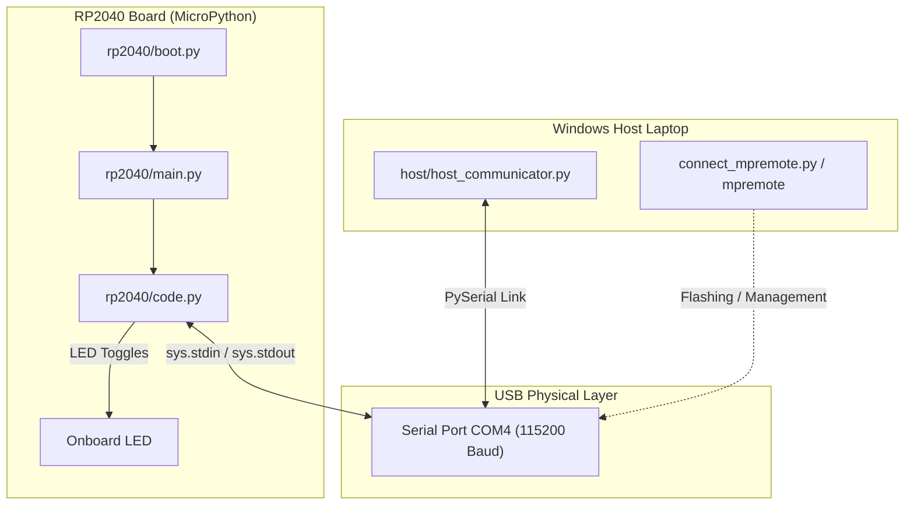
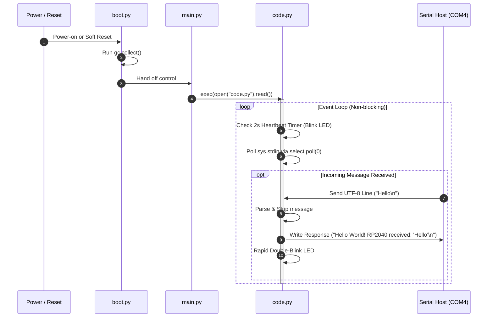
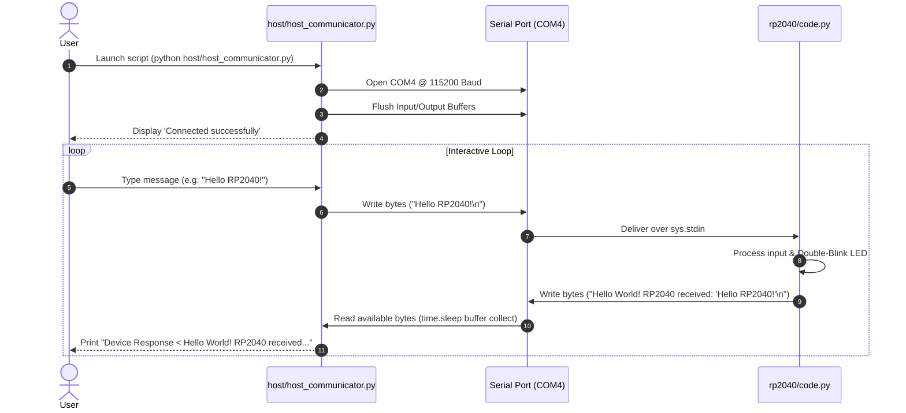

# USB Communicator: RP2040 & Host Serial Interface

This repository provides a complete, robust USB Serial (CDC) communication framework between a Windows Host system and an RP2040 microcontroller running **MicroPython**.

---

## Architecture Overview

Communication occurs over a USB CDC serial link operating at **115200 baud rate** (defaulting to **COM4**).



---

## Directory Structure & File Overview

```
USBCommunicator/
├── host/
│   ├── host_communicator.py   # Interactive host serial client
│   └── requirements.txt        # Host Python dependencies (pyserial)
├── rp2040/
│   ├── boot.py                 # Startup script run once on MicroPython boot
│   ├── main.py                 # Main entry point triggering code.py
│   └── code.py                 # Core non-blocking serial handler & LED control
├── connect_mpremote.py         # Python helper to run mpremote from .venv on COM4
├── connect_mpremote.bat        # Command Prompt shortcut for mpremote on COM4
└── connect_mpremote.ps1        # PowerShell shortcut for mpremote on COM4
```

---

## `rp2040/` Directory Breakdown (MicroPython Board Code)

The `rp2040/` directory contains all Python scripts intended to run directly on the RP2040 chip under MicroPython.

### 1. [`rp2040/boot.py`](file:///D:/Git/USBCommunicator/rp2040/boot.py)
* **Purpose**: Executed automatically by MicroPython once upon system startup/power-on before `main.py`.
* **Functionality**: Performs clean garbage collection (`gc.collect()`). Kept lightweight to avoid startup crashes.

### 2. [`rp2040/main.py`](file:///D:/Git/USBCommunicator/rp2040/main.py)
* **Purpose**: Auto-started by MicroPython immediately following `boot.py`.
* **Functionality**: Serves as the execution entry point, calling `exec(open("code.py").read())` to launch `code.py`.

### 3. [`rp2040/code.py`](file:///D:/Git/USBCommunicator/rp2040/code.py)
* **Purpose**: Core application logic running in an infinite event loop.
* **Key Mechanisms**:
  - **Non-blocking Polling**: Uses `select.poll()` registered on `sys.stdin` with zero timeout (`poller.poll(0)`), ensuring the loop never blocks waiting for input.
  - **Periodic Heartbeat**: Flashes the onboard LED for 20ms every 2 seconds using non-blocking `time.ticks_ms()` comparisons.
  - **Serial Data Reading**: Reads incoming lines via `sys.stdin.readline()`, strips trailing line breaks, and ignores empty lines.
  - **Response Generation**: Formats a greeting response (`Hello World! RP2040 received: '<message>'`) and writes it back to `sys.stdout`.
  - **Visual Acknowledgment**: Flashes the onboard LED rapidly twice whenever a message is processed.

### RP2040 Board Execution Sequence



---

## `host/` Directory Breakdown (Host Machine Code)

The `host/` directory contains all Python scripts and configuration required on the laptop/PC host side to communicate with the RP2040 board.

### 1. [`host/host_communicator.py`](file:///D:/Git/USBCommunicator/host/host_communicator.py)
* **Purpose**: Interactive terminal application to scan COM ports, connect to the board, and send/receive real-time messages.
* **Key Functions**:
  - `scan_ports()`: Uses `pyserial` to discover all active COM ports without hardware vendor or board manufacturer filtering.
  - `select_port(requested_port)`: Defaults to **`COM4`** (or accepts CLI argument override) and verifies port availability.
  - `main()`: Opens a `serial.Serial` connection at **115200 baud**, flushes buffers, and enters an interactive prompt (`MicroPython [COM4] > `). Formats outgoing messages with single `\n` line endings and prints device responses.

### 2. [`host/requirements.txt`](file:///D:/Git/USBCommunicator/host/requirements.txt)
* **Purpose**: Specifies Python package requirements (`pyserial>=3.5`).

### Bidirectional Host-Board Communication Flow



---

## Quick Start Guide

### 1. Install Host Dependencies
Install `pyserial` into your Python virtual environment:
```powershell
pip install -r host/requirements.txt
```

### 2. Upload Code to the RP2040 Board
Use the workspace connection helper scripts to copy the board scripts to the RP2040 and soft-reset:
```powershell
python connect_mpremote.py cp rp2040/boot.py :boot.py
python connect_mpremote.py cp rp2040/code.py :code.py
python connect_mpremote.py cp rp2040/main.py :main.py
python connect_mpremote.py reset
```

### 3. Run the Host Communicator
Launch the host terminal interface:
```powershell
python host/host_communicator.py
```
Or specify a custom COM port:
```powershell
python host/host_communicator.py COM4 -b 115200
```

---

## Troubleshooting

* **Port Busy / Permission Denied**: Close any other applications accessing `COM4` (such as `mpremote`, PuTTY, Thonny, or VSCode Serial Monitor) before launching `host_communicator.py`.
* **No Response / Timeout**: Ensure `boot.py`, `main.py`, and `code.py` have been copied to the RP2040 board using `python connect_mpremote.py cp ...` and reset using `python connect_mpremote.py reset`.
* **Missing Board LED**: If your RP2040 board does not have an onboard LED on default pins (`LED` or pin 25), LED blinks are skipped without causing runtime errors.

