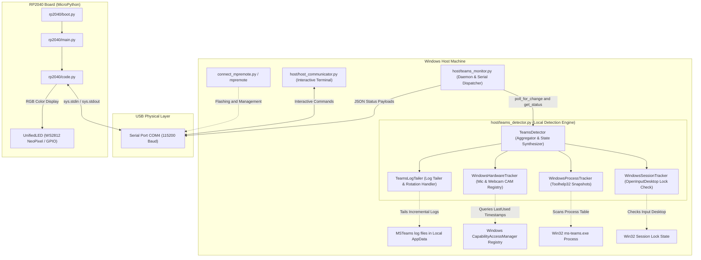
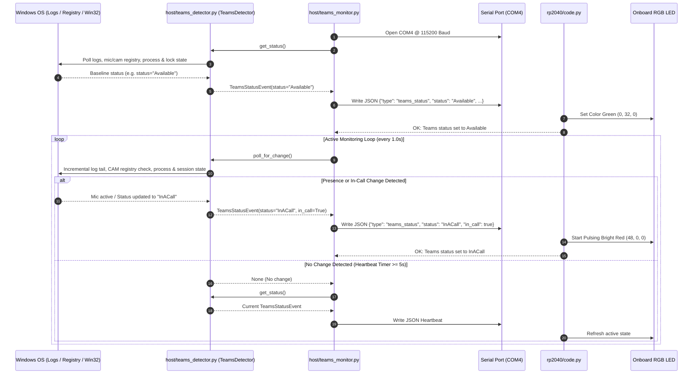
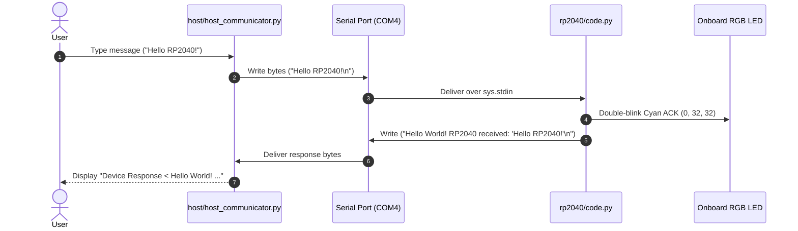

# USB Communicator: RP2040 & Host Serial Interface

This repository provides a complete, robust USB Serial (CDC) communication framework between a Windows Host system and an RP2040 microcontroller running **MicroPython**, featuring a **100% local, zero-network Microsoft Teams Status Monitor & Presence Light**.

---

## Architecture Overview

Communication occurs over a USB CDC serial link operating at **115200 baud rate** (defaulting to **COM4**).



---

## Directory Structure & File Overview

```
USBCommunicator/
├── host/
│   ├── teams_detector.py      # Core 100% local Teams status & hardware detection engine
│   ├── teams_monitor.py       # Standalone Teams monitor CLI & USB serial dispatcher
│   ├── test_teams_detector.py # Automated unit test suite (7 tests)
│   ├── host_communicator.py   # Interactive terminal serial client
│   └── requirements.txt       # Host Python dependencies (pyserial)
├── rp2040/
│   ├── boot.py                # Startup script run once on MicroPython boot
│   ├── main.py                # Main entry point triggering code.py
│   └── code.py                # Non-blocking serial handler, JSON parser & RGB LED control
├── connect_mpremote.py        # Python helper to run mpremote from .venv on COM4
├── connect_mpremote.bat       # Command Prompt shortcut for mpremote on COM4
└── connect_mpremote.ps1       # PowerShell shortcut for mpremote on COM4
```

---

## `host/` Component Breakdown

### 1. [`host/teams_detector.py`](file:///D:/Git/USBCommunicator/host/teams_detector.py)
Core detection engine that combines multiple local OS signals without external network access:
* **`TeamsLogTailer`**:
  * Auto-discovers the active Microsoft Teams log directory at `%LOCALAPPDATA%\Packages\MSTeams_8wekyb3d8bbwe\LocalCache\Microsoft\MSTeams\Logs`.
  * Incrementally tails `MSTeams_*.log` files by tracking byte offsets to minimize disk I/O.
  * Handles log rollover and rotation when Teams restarts or generates new timestamped log files.
  * Parses `UserPresenceAction` and multi-user `UserDataGlobalState` events to detect presence (`Available`, `Busy`, `DoNotDisturb`, `Away`, `BeRightBack`, `Offline`).
  * Parses `cross_cloud::meetingstore` size markers to detect active meetings.
* **`WindowsHardwareTracker`**:
  * Inspects Windows Registry `HKCU\Software\Microsoft\Windows\CurrentVersion\CapabilityAccessManager\ConsentStore` for `microphone` and `webcam` usage by `MSTeams_8wekyb3d8bbwe`.
  * Provides instant sub-second in-call detection when microphone or camera capture is active.
* **`WindowsProcessTracker`**:
  * Uses native Windows Toolhelp32 API (`ctypes`) to verify if `ms-teams.exe` is running vs closed.
* **`WindowsSessionTracker`**:
  * Checks desktop input session state to detect when the workstation is locked.
* **`TeamsDetector`**:
  * Aggregates all signals into normalized `TeamsStatusEvent` objects and provides `poll_for_change()`.

### 2. [`host/teams_monitor.py`](file:///D:/Git/USBCommunicator/host/teams_monitor.py)
Standalone CLI application and USB serial bridge:
* Runs an event loop checking for status changes and displays ASCII console badges (`[* AVAILABLE]`, `[# BUSY]`, `[! IN A CALL]`, `[- DO NOT DISTURB]`, etc.).
* Transmits newline-terminated JSON payloads to the RP2040 microcontroller over the selected COM port.
* Dispatches periodic keep-alive heartbeats (default every 5 seconds) to ensure microcontroller state stays in sync.
* Supports console-only standalone execution (`-s` / `--standalone`).

### 3. [`host/test_teams_detector.py`](file:///D:/Git/USBCommunicator/host/test_teams_detector.py)
Comprehensive unit test suite verifying:
* Status normalization and mapping.
* Initial log read and incremental tailing from byte offsets.
* Multi-user global state log parsing.
* Log file rotation handling.
* JSON serialization format.
* State aggregation logic under mocked process, session, and hardware states.

### 4. [`host/host_communicator.py`](file:///D:/Git/USBCommunicator/host/host_communicator.py)
Interactive terminal client for manual serial testing, port discovery, and raw message sending.

---

## `rp2040/` Component Breakdown (MicroPython Board)

### 1. [`rp2040/boot.py`](file:///D:/Git/USBCommunicator/rp2040/boot.py)
Runs once on hardware reset / power-on before `main.py`. Performs clean garbage collection.

### 2. [`rp2040/main.py`](file:///D:/Git/USBCommunicator/rp2040/main.py)
Auto-started entry point that executes `code.py`.

### 3. [`rp2040/code.py`](file:///D:/Git/USBCommunicator/rp2040/code.py)
* **Non-blocking Polling**: Uses `select.poll()` on `sys.stdin` with zero timeout (`poll(0)`).
* **Hardware Abstraction (`UnifiedLED`)**: Automatically detects WS2812 NeoPixels (on board definition or GPIO 16, e.g. Waveshare RP2040-Zero/Matrix) or standard GPIO LEDs (Raspberry Pi Pico pin `"LED"`, GPIO 25, or GPIO 13).
* **JSON Payload Handling**: Automatically parses incoming Teams status JSON payloads, updates internal state, and adjusts LED colors.
* **Plain-Text Compatibility**: Responds to plain-text messages with greeting strings and double-blinks cyan ACK.

---

## Communication Protocols

### 1. Teams Status JSON Protocol (Automated Monitor)
Transmitted over serial by `teams_monitor.py` on state change or heartbeat:
```json
{
  "type": "teams_status",
  "status": "Available",
  "availability": "Available",
  "in_call": false,
  "in_meeting": false,
  "mic_active": false,
  "camera_active": false,
  "is_running": true,
  "is_locked": false,
  "timestamp": "2026-08-19T12:19:43.048989-05:00"
}
```

Microcontroller response:
```
OK: Teams status set to Available
```

### 2. RP2040 LED Color Mapping

| Status | LED Color | RGB Value | Behavior |
| :--- | :--- | :--- | :--- |
| **Available** | Gentle Green | `(0, 32, 0)` | Solid |
| **Busy** | Red | `(32, 0, 0)` | Solid |
| **In A Call / In A Meeting** | Bright Red | `(48, 0, 0)` | Pulsing animation (600ms cycle) |
| **Do Not Disturb** | Magenta / Purple | `(32, 0, 32)` | Solid |
| **Away / Be Right Back** | Amber / Yellow | `(32, 20, 0)` | Solid |
| **Offline / Not Running** | Off | `(0, 0, 0)` | Faint 20ms blip every 3s (heartbeat) |
| **Unknown** | Dim Cyan | `(0, 16, 32)` | Solid |

---

## Sequence Diagrams

### Teams Status Monitoring Sequence


### Interactive Serial Terminal Sequence


---

## Quick Start Guide

### 1. Install Host Dependencies
```powershell
pip install -r host/requirements.txt
```

### 2. Upload Code to the RP2040 Board
Use the workspace connection helper scripts to copy board scripts to the RP2040 and soft-reset:
```powershell
python connect_mpremote.py cp rp2040/boot.py :boot.py
python connect_mpremote.py cp rp2040/code.py :code.py
python connect_mpremote.py cp rp2040/main.py :main.py
python connect_mpremote.py reset
```

### 3. Run the Standalone Teams Status Monitor
Run in full mode (monitors Teams and sends updates to the RP2040 over `COM4`):
```powershell
python host/teams_monitor.py --port COM4
```

Or run in console-only standalone mode (without serial connection):
```powershell
python host/teams_monitor.py --standalone
```

#### CLI Options for `teams_monitor.py` / `TeamsMonitor.exe`
| Argument | Description | Default |
| :--- | :--- | :--- |
| `-p`, `--port` | Target USB Serial COM port | `COM4` |
| `-b`, `--baudrate` | Serial baud rate | `115200` |
| `-i`, `--interval` | Log & state polling interval in seconds | `1.0` |
| `-H`, `--heartbeat` | Periodic serial heartbeat interval in seconds (`0` to disable) | `5.0` |
| `-s`, `--standalone` | Run in console-only mode without opening a COM port | `False` |
| `--log-dir` | Custom path to Microsoft Teams log directory | Auto-detected |
| `--log-file` | Path to save diagnostic log output (ideal for background execution) | `None` |
| `--install-startup` | Register monitor to start automatically on Windows logon | `None` |
| `--uninstall-startup` | Remove monitor from Windows Startup | `False` |
| `--startup-status` | Display current Windows Startup registration status | `False` |

---

### 4. Build Standalone `.exe` & Auto-Start on Windows

You can package the monitor into a single windowless executable (`dist/TeamsMonitor.exe`) that starts automatically in the background when you log into Windows:

#### Step 1: Build the Executable
```powershell
# Using the batch shortcut or Python builder
.\build_exe.bat
# or: python build_exe.py
```
This produces `dist\TeamsMonitor.exe` (~7.9 MB, compiled with `--noconsole` for silent execution).

#### Step 2: Register with Windows Startup (One-Time Setup)
```powershell
dist\TeamsMonitor.exe --install-startup
```
This registers `TeamsMonitor.exe` directly into `HKCU\Software\Microsoft\Windows\CurrentVersion\Run`.  
It will automatically appear in **Windows Task Manager > Startup apps** tab with an **Enabled/Disabled** toggle.

#### Step 3: Check or Manage Startup Anytime
```powershell
# Check current registration:
dist\TeamsMonitor.exe --startup-status

# Remove from Windows startup:
dist\TeamsMonitor.exe --uninstall-startup
```

---

### 5. Run Automated Unit Tests
```powershell
python -m unittest discover -s host -p "test_*.py"
```

### 6. Run the Interactive Host Terminal (Manual Test Mode)
```powershell
python host/host_communicator.py
```
Or specify a custom COM port:
```powershell
python host/host_communicator.py COM4 -b 115200
```

---

## Troubleshooting

* **Port Busy / Permission Denied**: Close any other applications accessing `COM4` (such as `mpremote`, PuTTY, Thonny, or VSCode Serial Monitor) before launching `teams_monitor.py` or `host_communicator.py`.
* **No Response / Timeout**: Ensure `boot.py`, `main.py`, and `code.py` have been uploaded to the RP2040 board using `python connect_mpremote.py cp ...` and reset using `python connect_mpremote.py reset`.
* **Custom Teams Log Location**: If your Teams installation logs to a custom directory, pass `--log-dir "C:\path\to\Logs"`.
* **Board Hardware Compatibility**: Works with standard Raspberry Pi Pico (onboard single-color LED) and RP2040 boards with WS2812 NeoPixel LEDs (e.g. Waveshare RP2040-Zero, RP2040-Matrix, Adafruit Feather RP2040).

