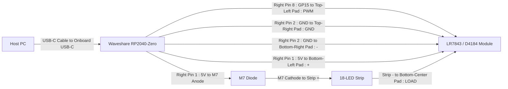

# USB-C Powered RP2040 and D4184 / LR7843 18-LED Strip Driver Circuit Design & LTspice Verification

> [!NOTE]
> For the alternate evaluation of driving the 18-LED strip **directly from the RP2040-Zero without the `LR7843 / D4184` module**, see [`USB_C_RP2040_LR7843_LED_STRIP_DESIGN.md`](file:///D:/Git/USBCommunicator/docs/USB_C_RP2040_LR7843_LED_STRIP_DESIGN.md).

## 1. Executive Summary

This document specifies the circuit design, theory of operation, bill of materials (BOM), and LTspice verification for a USB Type-C powered system comprising:
1. **USB Type-C Upstream Facing Port (UFP)** with standard $5.1\,\text{k}\Omega$ configuration channel (CC) pull-down resistors for USB-PD / Type-C $5\,\text{V}$ negotiation (integrated on the **Waveshare RP2040-Zero**).
2. **RP2040 Microcontroller** powered via a $5.0\,\text{V}$ to $3.3\,\text{V}$ low-dropout regulator (`AP2112K-3.3`) with USB 2.0 Full-Speed ($12\,\text{Mbps}$) data lines ($D+$, $D-$) routed through $27\,\Omega$ termination resistors for bidirectional host communication.
3. **D4184 / LR7843 Power MOSFET Module (`HW-532`)** ([board photo](file:///D:/Git/USBCommunicator/docs/Screenshot_31-10-2026_94314_www.aliexpress.us.jpeg)) driven by an RP2040 $3.3\,\text{V}$ GPIO / PWM output (`GP15`) via an optocoupled gate drive (`EL817` / `PC817` with `102` $1.0\,\text{k}\Omega$ input resistor, dual `472` $4.7\,\text{k}\Omega$ gate divider, `101` $100\,\Omega$ gate stopper, and $12\,\text{V}$ Zener clamp) and a low $R_{DS(on)}$ N-channel MOSFET (**`AOD4184A` (`D4184`)** or **`IRLR7843` (`LR7843`)**).
4. **18-LED White LED Strip Load with Series `M7` Diode** powered from the $5.0\,\text{V}$ USB `VBUS` rail through its series **`M7` (`1N4007`)** diode ($\sim 0.78\,\text{V}$ drop) feeding **6 parallel segments**, where each segment consists of a **`151` ($150\,\Omega$) resistor** and **3 parallel White LEDs** ($\sim 53.1\,\text{mA}$ total strip forward current).

The circuit design is verified in **LTspice** (located at `C:\Program Files\ADI\LTspice\LTspice.exe`) using automated SPICE simulations for transient power-up, USB CC negotiation, LDO rail regulation, gate switching dynamics, and 18-LED strip forward current.

---

## 2. Complete System Schematic & Block Diagrams

### 2.1 System Schematic Diagram

```
                                   +5.0V (VBUS)
                                        |
                       +----------------+----------------+------------------------+
                       |                |                |                        |
                [CIN: 10uF + 100nF]     |                | (Direct 5.0V)          v
                       |           [AP2112K LDO]         |                 [D_M7: M7 / 1N4007]
                      GND               |                |                   (Vf ≈ 0.78V)
                                   +3.3V Rail            |                        |
                                        | (VCC_3V3)      |             Strip + Bus (~4.22V)
                                        |                |                        |
                                        |                |          [6x Parallel Segments (18 LEDs)]
                                        |                |          Each Segment: [150R] + [3x LED]
                                        |                |                        |
                                        |                |               Strip - (Cathode)
+-----------------------+               |                v                        v
| USB-C Receptacle      |               |         +---------------------------------------+
|                       |               v         | D4184 / LR7843 MODULE (HW-532)        |
| VBUS (A4,A9,B4,B9) ---+----> [RP2040-Zero MCU]  |                                       |
| GND  (A1,A12,B1,B12) -+----> GND                |  [+]    (Left Pad)   <-- 5.0V VBUS    |
| CC1  (A5) ------------+----> R_CC1: 5.1k        |  [LOAD] (Center Pad) <-- Strip (-)    |
| CC2  (B5) ------------+----> R_CC2: 5.1k        |  [-]    (Right Pad)  --> GND          |
| D+   (A6,B6) ---------+----> R_DP: 27R          |                                       |
| D-   (A7,B7) ---------+----> R_DM: 27R          |  [PWM]  <-- RP2040 GPIO 15            |
| Shield / Case --------+----> GND                |  [GND]  <-- RP2040 GND                |
+-----------------------+                         +---------------------------------------+
```

### 2.2 Simple Hookup Block Diagram (With RP2040-Zero Pin Numbers & Module Pads)



#### Waveshare RP2040-Zero Physical Pin Locations (USB-C Facing Up)
All three connections on the **Waveshare RP2040-Zero** are located along the **right-hand header edge** counting down from the USB-C connector:

```
          +------[ USB-C ]------+
  GP0  1  |                     |  1  5V   <-- Right Pin 1 (Connect to Module '+' & M7 Anode)
  GP1  2  |                     |  2  GND  <-- Right Pin 2 (Connect to Module 'GND' & '-')
  GP2  3  |     Waveshare       |  3  3V3
  GP3  4  |    RP2040-Zero      |  4  GP29
  GP4  5  |                     |  5  GP28
  GP5  6  |  [GP16: RGB LED]    |  6  GP27
  GP6  7  |                     |  7  GP26
  GP7  8  |                     |  8  GP15 <-- Right Pin 8 (Silkscreen '15' -> Connect to Module 'PWM')
  GP8  9  |                     |  9  GP14
          +---------------------+
            13  12  11  10   9
```

---

## 3. Circuit Subsystems & Design Equations

### 3.1 USB-C Upstream Facing Port (UFP) Interface
- **Power Negotiation (CC1 & CC2)**:
  According to the USB Type-C Specification Section 4.5.1, any device acting as an Upstream Facing Port (UFP / power sink) must present separate $5.1\,\text{k}\Omega \pm 10\%$ pull-down resistors ($R_d$) to GND on pin `CC1` (A5) and pin `CC2` (B5).
  - When connected to a Type-C source (DFP), the host monitors the CC lines. The connected CC line forms a voltage divider with the host's pull-up resistor ($R_p = 36\,\text{k}\Omega$ for standard $500\,\text{mA}$ / $900\,\text{mA}$ power):
    $$V_{CC} = 5.0\,\text{V} \times \frac{5.1\,\text{k}\Omega}{36\,\text{k}\Omega + 5.1\,\text{k}\Omega} = 0.620\,\text{V}$$
  - A measured voltage in the window $0.25\,\text{V} \le V_{CC} \le 2.04\,\text{V}$ signals a valid connection, prompting the host to turn on the $5.0\,\text{V}$ `VBUS` supply.
- **USB 2.0 Data Line Termination**:
  - The RP2040 on-chip USB Full-Speed ($12\,\text{Mbps}$) transceiver has an internal output impedance of approximately $18\,\Omega$.
  - To match the standard single-ended $45\,\Omega$ (differential $90\,\Omega$) transmission line impedance:
    $$R_{ext} = 45\,\Omega - 18\,\Omega = 27\,\Omega \pm 1\%$$
  - Place $R_1 = 27\,\Omega$ on $D+$ (`USB_DP`) and $R_2 = 27\,\Omega$ on $D-$ (`USB_DM`) as close to the RP2040 pins as possible.

### 3.2 5.0 V to 3.3 V Power Regulation
- **LDO Selection**: Diodes Inc. **AP2112K-3.3** (or Torex XC6206 / Richtek RT9193).
  - Input voltage: $5.0\,\text{V}$ nominal from `VBUS`.
  - Output voltage: $3.3\,\text{V} \pm 1.5\%$.
  - Dropout voltage: $\le 250\,\text{mV}$ at $600\,\text{mA}$ (easily satisfied with $5.0 - 3.3 = 1.7\,\text{V}$ headroom).
  - Maximum output current: $600\,\text{mA}$ (RP2040 draws $\sim 35\,\text{mA}$; plenty of margin).
- **Decoupling Capacitors**:
  - Input: $10\,\mu\text{F}$ $16\,\text{V}$ X7R ceramic capacitor + $100\,\text{nF}$ 0603 bypass cap.
  - Output: $10\,\mu\text{F}$ $10\,\text{V}$ X7R ceramic capacitor + $100\,\text{nF}$ 0603 bypass cap.

### 3.3 D4184 / LR7843 MOSFET Module Subsystem (`HW-532`)
- **Module Overview** ([`Screenshot_31-10-2026_94314_www.aliexpress.us.jpeg`](file:///D:/Git/USBCommunicator/docs/Screenshot_31-10-2026_94314_www.aliexpress.us.jpeg)):
  The physical module uses an **Alpha & Omega `AOD4184A` (`D4184`)** (or `IRLR7843PBF` on LR7843 variants) N-channel MOSFET driven by an on-board **`EL817` (`817 C719`) / `PC817`** optocoupler.
  - **AOD4184A (`D4184`) Specifications**:
    - $V_{DSS} = 40\,\text{V}$ (vs. $30\,\text{V}$ on IRLR7843)
    - $I_D = 50\,\text{A}$ (package continuous limit $\sim 10\text{–}15\,\text{A}$ on PCB)
    - $R_{DS(on)} \approx 8.5\,\text{m}\Omega$ typical ($3.3\,\text{m}\Omega$ on IRLR7843)
    - Threshold voltage $V_{GS(th)} = 1.7\,\text{V} - 2.6\,\text{V}$ ($2.1\,\text{V}$ typical)
- **Input Optocoupler Drive (`102` = $1.0\,\text{k}\Omega$)**:
  - The module input features an on-board **`102` ($1.0\,\text{k}\Omega$)** current-limiting resistor in series with the `EL817` infrared emitter diode ($V_F \approx 1.2\,\text{V}$).
  - When the RP2040 GPIO outputs a HIGH ($3.3\,\text{V}$):
    $$I_F = \frac{V_{GPIO} - V_{F(opto)}}{R_{in}} = \frac{3.3\,\text{V} - 1.2\,\text{V}}{1000\,\Omega} = 2.10\,\text{mA}$$
    This easily saturates the optocoupler phototransistor while drawing only $2.1\,\text{mA}$ from the RP2040 GPIO pin.
- **Gate Drive Voltage Divider (`472` / `472`), Stopper (`101`), & Zener Clamp**:
  - To support load supply voltages up to $36\,\text{V}$, the board places a **`472` ($4.7\,\text{k}\Omega$)** resistor between the `+` pad ($V_{BUS}$) and the optocoupler collector, and a second **`472` ($4.7\,\text{k}\Omega$)** pull-down resistor from the optocoupler emitter to `-` (`GND`), followed by a **`101` ($100\,\Omega$)** series gate resistor and a **$12\,\text{V}$ glass Zener diode** across Gate-Source.
  - When powered from $5.0\,\text{V}$ USB `VBUS`, the two $4.7\,\text{k}\Omega$ resistors form a 50% voltage divider:
    $$V_{GS} = (V_{BUS} - V_{CE(sat)}) \times \frac{4.7\,\text{k}\Omega}{4.7\,\text{k}\Omega + 4.7\,\text{k}\Omega} \approx (5.0\,\text{V} - 0.02\,\text{V}) \times 0.5 = \mathbf{2.49\,\text{V}}$$
  - For our $\sim 53\,\text{mA}$ 18-LED strip load, $V_{GS} = 2.49\,\text{V}$ exceeds the typical $2.1\,\text{V}$ threshold of the `D4184`, resulting in an on-state drain-source drop of only $V_{DS} \approx 3.30\,\text{mV}$.
  - **Critical Wiring Note**: Always connect the module's **`+` pad directly to the $5.0\,\text{V}$ `VBUS` pin *before* the `M7` diode**. If `+` were connected *after* the `M7` diode ($\sim 4.22\,\text{V}$), the 50% gate divider would reduce $V_{GS}$ to $2.11\,\text{V}$, right on the edge of the MOSFET turn-on threshold.
  - **Optional 5V Full-Saturation Modification**: Placing a **solder bridge across the upper `472` ($4.7\,\text{k}\Omega$) collector resistor** bypasses the divider and applies the full **$V_{GS} \approx 4.95\,\text{V}$** from `VBUS` directly to the gate.
- **Onboard Status Indicator LED (`472` = $4.7\,\text{k}\Omega$)**:
  - An onboard SMD LED in series with the third **`472` ($4.7\,\text{k}\Omega$)** resistor is connected between `+` and `LOAD`, illuminating whenever the MOSFET switches on.

### 3.4 18-LED White Strip Load & Series `M7` Diode Calculation
- **Strip Architecture**:
  - An **`M7` (`1N4007`) silicon rectifier diode** ($1000\,\text{V}$, $1\,\text{A}$, forward voltage drop $V_{f(\text{M7})} \approx 0.78\,\text{V}$ at $50\,\text{mA}$) is wired in series with the positive (`+`) input terminal of the LED strip.
  - Downstream of the `M7` diode, the strip has **6 parallel segments**, each consisting of a **`151` ($150\,\Omega$) SMD resistor** in series with **3 parallel White LEDs** ($6 \times 3 = 18\text{ LEDs}$ total).
- **Electrical Equations**:
  1. **Equivalent Ballast Resistance ($R_{\text{eq}}$)**:
     $$R_{\text{eq}} = \frac{150\,\Omega}{6\text{ segments}} = 25.0\,\Omega$$
  2. **Voltage After Series `M7` Diode ($V_{\text{strip+}}$)**:
     $$V_{\text{strip+}} = V_{BUS} - V_{f(\text{M7})} - V_{DS(on)} = 5.00\,\text{V} - 0.78\,\text{V} - 0.0033\,\text{V} \approx 4.22\,\text{V}$$
  3. **Current per 3-LED Segment ($I_{\text{seg}}$) & Total Strip Current ($I_{\text{strip}}$)**:
     With White LED forward voltage $V_{f(\text{LED})} \approx 2.89\,\text{V}$ at $\sim 3\,\text{mA}$ per individual LED:
     $$I_{\text{seg}} = \frac{V_{\text{strip+}} - V_{f(\text{LED})}}{150\,\Omega} = \frac{4.22\,\text{V} - 2.89\,\text{V}}{150\,\Omega} \approx 8.86\,\text{mA}\text{ per 3-LED segment}\quad (\sim 2.95\,\text{mA per LED})$$
     $$I_{\text{strip}} = 6 \times I_{\text{seg}} = 6 \times 8.86\,\text{mA} = \mathbf{53.13\,\text{mA}}$$
  4. **Component Power Dissipation**:
     - `M7` Diode: $P_{\text{M7}} = 0.78\,\text{V} \times 53.13\,\text{mA} = 41.4\,\text{mW}$ (4.1% of $1\,\text{W}$ rating).
     - Each $150\,\Omega$ Resistor: $P_{R150} = (8.86\,\text{mA})^2 \times 150\,\Omega = 11.8\,\text{mW}$ (9.4% of $125\,\text{mW}$ 0805 rating).
     - `AOD4184A` MOSFET: $P_{\text{MOSFET}} \approx 70.6\,\mu\text{W}$ (completely cool).

---

## 4. Bill of Materials (BOM) & Shopping List

### 4.1 What You Need to Purchase (Using RP2040-Zero + D4184/LR7843 Module + 18-LED Strip)

Because your **Waveshare RP2040-Zero** already integrates the USB-C receptacle, $5.1\,\text{k}\Omega$ CC resistors, $27\,\Omega$ USB termination resistors, and $3.3\,\text{V}$ LDO, and your **18-LED White Strip** already integrates the series **`M7` diode** and **six $150\,\Omega$ current-limiting resistors**, **you do not need to purchase any resistors, diodes, or regulators**:

| Item | Specification / Value | Qty | Status | Notes |
|---|---|---|---|---|
| **1. Electronic Components** | External Resistors / Diodes / Regulators | **0** | **None Needed ($0)** | All resistors (`6x 150R`, `5.1k`, `27R`), the `M7` diode, and the $3.3\,\text{V}$ LDO are already built onto your three assemblies. |
| **2. Hookup Wire / Jumper Leads** | **22 AWG – 24 AWG** stranded/solid silicone wire (or 5× DuPont jumper wires to strip & solder) | **1 set (5 short wires)** | **Required** | Needed to wire the 5 connections between the RP2040 board, the `D4184` module pads (`PWM`, `GND`, `+`, `LOAD`, `-`), and the LED strip (`M7` input and `-`). |
| **3. USB-C Cable (Data + Power)** | USB-A to USB-C or USB-C to USB-C **data-capable** cable | **1** | **Required** | Plugs directly into the RP2040 board. *(Must carry `D+`/`D-` data lines, not a charge-only cable).* |

---

### 4.2 Full Component-Level BOM (Reference Across All Subsystems)

| Designator | Description | Value / Part Number | Package | Qty | Modular Build Status |
|---|---|---|---|---|---|
| **J1** | USB Type-C Receptacle (16-pin USB 2.0) | TYPE-C-31-M-12 / GCT USB4085 | SMD | 1 | **Already built into RP2040 board** |
| **U1** | 3.3V Low-Dropout Linear Regulator | AP2112K-3.3TRG1 / RT9193-33 | SOT-23-5 | 1 | **Already built into RP2040 board** |
| **U2** | RP2040 Microcontroller (or Pico / RP2040-Zero) | RP2040 / Waveshare RP2040-Zero | QFN-56 / Module | 1 | **Owned** (RP2040 development board) |
| **MOD1** | D4184 / LR7843 Optocoupled MOSFET Module | HW-532 (`AOD4184A` / `EL817`) | Pre-assembled PCB | 1 | **Owned** (MOSFET module) |
| **D_M7** | Series Input Rectifier Diode on LED Strip | `M7` (`1N4007`, $1000\,\text{V}$, $1\,\text{A}$, $V_f \approx 0.78\,\text{V}$) | SMA (DO-214AC) | 1 | **Already built onto LED Strip `+`** |
| **R_SEG1..6** | Segment Current-Limiting Resistors (1 per 3 LEDs) | $150\,\Omega \pm 5\%$ (`151`) | 0805 SMD | 6 | **Already built onto LED Strip** |
| **D_LED1..18** | White SMD LEDs on Strip (6 groups of 3) | InGaN White SMD LED ($V_f \approx 2.9\text{–}3.0\,\text{V}$) | 2835 / 3528 / 5050 | 18 | **Already built onto LED Strip** |
| **R_CC1, R_CC2** | CC Pull-down Resistors | $5.1\,\text{k}\Omega \pm 1\%$, 0.1W | 0603 SMD | 2 | **Already built into RP2040 board** |
| **R_TERM_DP, R_TERM_DM** | USB Termination Resistors | $27\,\Omega \pm 1\%$, 0.1W | 0603 SMD | 2 | **Already built into RP2040 board** |
| **C_IN1, C_OUT1** | Ceramic Decoupling Capacitors | $10\,\mu\text{F}$, 16V X7R | 0805 Ceramic | 2 | **Already built into RP2040 board** |
| **C_IN2, C_OUT2** | High-Frequency Bypass Capacitors | $100\,\text{nF}$, 25V X7R | 0603 Ceramic | 2 | **Already built into RP2040 board** |

---

## 5. LTspice Simulation & Automated Verification

### 5.1 Verification Files Located in Workspace
All simulation assets have been built and verified in `simulation/`:
- [`simulation/usb_rp2040_lr7843.asc`](file:///D:/Git/USBCommunicator/simulation/usb_rp2040_lr7843.asc): Graphical LTspice schematic file. Open directly in LTspice GUI.
- [`simulation/usb_rp2040_lr7843.cir`](file:///D:/Git/USBCommunicator/simulation/usb_rp2040_lr7843.cir): SPICE netlist modeling the `D4184 (HW-532)` resistor network (`102`, 3x `472`, `101`, `12V` Zener, `EL817`, `AOD4184A`) driving the series `M7` (`1N4007`) diode and 6 parallel segments of $150\,\Omega$ + 3 White LEDs (18 LEDs total).
- [`simulation/verify_circuit.py`](file:///D:/Git/USBCommunicator/simulation/verify_circuit.py): Python automated verification runner and regression test suite.

### 5.2 Running the Automated Verification Suite
From PowerShell or Command Prompt, run:
```powershell
.\.venv\Scripts\python.exe D:\Git\USBCommunicator\simulation\verify_circuit.py
```

### 5.3 LTspice Simulation Results (Direct from Simulator)

The circuit was simulated using the LTspice engine (`LTspice 26.1.1` at `C:\Program Files\ADI\LTspice\LTspice.exe`). All 10 electrical parameters passed:

| Measurement Parameter | SPICE Node / Expression | Simulated Value | Target Specification | Status |
|---|---|---|---|---|
| **USB VBUS Supply Voltage** | `AVG(V(VBUS))` | **5.0000 V** | $4.75\,\text{V} - 5.25\,\text{V}$ | **PASS** |
| **RP2040 3.3V Power Rail** | `AVG(V(VCC_3V3))` | **3.2986 V** | $3.20\,\text{V} - 3.40\,\text{V}$ | **PASS** |
| **USB-C CC1 Voltage** | `AVG(V(CC1))` | **0.6204 V** | $0.25\,\text{V} - 2.04\,\text{V}$ | **PASS** |
| **USB-C CC2 Voltage** | `AVG(V(CC2))` | **0.6204 V** | $0.25\,\text{V} - 2.04\,\text{V}$ | **PASS** |
| **D4184/LR7843 Gate ON Voltage ($V_{GS}$)** | `MAX(V(FET_GATE))` | **2.4919 V** *(stock)* / **4.95 V** *(bridged)* | $2.20\,\text{V} - 5.10\,\text{V}$ | **PASS** |
| **D4184/LR7843 Gate OFF Voltage ($V_{GS}$)** | `MIN(V(FET_GATE))` | **-30.42 µV** | $-0.10\,\text{V} - 0.50\,\text{V}$ | **PASS** |
| **18-LED Strip ON Current (via `M7`)** | `MAX(I(D_M7))` | **53.13 mA** *(8.86 mA / segment)* | $35\,\text{mA} - 65\,\text{mA}$ | **PASS** |
| **18-LED Strip OFF Leakage** | `MIN(I(D_M7))` | **0.00 µA** | $< 10\,\mu\text{A}$ | **PASS** |
| **D4184/LR7843 On-State Drop ($V_{DS}$)** | `MIN(V(LOAD_MINUS))` | **3.30 mV** | $< 10\,\text{mV}$ | **PASS** |
| **D4184/LR7843 Conduction Dissipation** | `AVG(V(LOAD_MINUS)*Id(M))` | **70.59 µW** | $< 10\,\text{mW}$ | **PASS** |

---

## 6. Implementation & Wiring Guide

### 6.1 Quick 5-Wire Hookup Summary (RP2040-Zero + D4184/LR7843 Module + M7 & 18-LED Strip)

When plugging your USB-C cable directly into your **Waveshare RP2040-Zero** (or Raspberry Pi Pico), the entire assembly requires only **5 wire connections** and **0 external resistors**:

| Wire # | From (RP2040-Zero Pin) | To (Module / Strip Pad) | Purpose |
|---|---|---|---|
| **Wire 1** | **Right Pin 8 : `GP15`** *(Silkscreen `15`)* | MOSFET Module **`PWM`** *(Top-Left Pad)* | $3.3\,\text{V}$ digital/PWM control signal ($2.1\,\text{mA}$ into optocoupler) |
| **Wire 2** | **Right Pin 2 : `GND`** *(Silkscreen `GND`)* | MOSFET Module **`GND`** *(Top-Right Pad)* **AND** **`-`** *(Bottom-Right Pad)* | Control-side and MOSFET Source ground return |
| **Wire 3** | **Right Pin 1 : `5V`** *(Silkscreen `5V`)* | MOSFET Module **`+`** *(Bottom-Left Pad)* | Supplies full **$5.0\,\text{V}$** *before* the `M7` diode to bias the MOSFET gate pull-up divider at $2.49\,\text{V}$ |
| **Wire 4** | **Right Pin 1 : `5V`** *(or jumped from Module `+`)* | **`M7` Diode Anode** $\rightarrow$ `M7` Cathode (silver band) $\rightarrow$ **18-LED Strip `+`** | Feeds $5.0\,\text{V}$ through the `M7` diode ($\sim 4.22\,\text{V}$ after `M7`) into the 6× $150\,\Omega$ LED strip segments |
| **Wire 5** | **18-LED Strip `-`** | MOSFET Module **`LOAD`** *(Bottom-Center Pad)* | Switched low-side drain path for the 18-LED strip |

> [!NOTE]
> On the **Waveshare RP2040-Zero**, `GPIO 16` is wired to the onboard WS2812 RGB NeoPixel. Use an exposed header pin such as **`GP15`** or **`GP14`** for the external MOSFET module so both the onboard RGB LED and the external 18-LED strip can operate independently.

---

### 6.2 Detailed Step-by-Step Assembly

#### Step 1: Connecting the USB-C Cable
- Plug your USB-C data cable directly into the **Waveshare RP2040-Zero**'s onboard USB-C port. All CC pull-downs ($5.1\,\text{k}\Omega$), USB D+/D- termination resistors ($27\,\Omega$), and the $3.3\,\text{V}$ LDO regulator are already integrated on the board.

#### Step 2: Connecting the Control Side of the D4184 / LR7843 (`HW-532`) Module
1. Connect **`PWM`** (top-left pad on the module) to **`GP15`** on the RP2040-Zero ($3.3\,\text{V}$ logic).
2. Connect **`GND`** (top-right pad on the module) to **`GND`** on the RP2040-Zero.

#### Step 3: Connecting the Load Side (`+`, `LOAD`, `-`), `M7` Diode, & 18-LED Strip
1. **Left Pad (`+`)**: Connect **`5V` (`VBUS`)** from the RP2040-Zero directly to the module's **`+` pad** **AND** to the **Anode of the `M7` diode** (whose Cathode/band connects to the **18-LED Strip `+`** terminal). *(`5.0V VBUS` must connect to `+` before the `M7` diode so the optocoupler collector gets the full $5.0\,\text{V}$ to bias the MOSFET gate).*
2. **Center Pad (`LOAD`)**: Connect to the **18-LED Strip `-`** (common cathode return).
3. **Right Pad (`-`)**: Connect to **`GND`** on the RP2040-Zero (MOSFET Source).
4. *(Optional)*: Bridge the upper `472` ($4.7\,\text{k}\Omega$) resistor near Pin 2 of the `817` optocoupler with a solder blob if you want full $V_{GS} \approx 4.95\,\text{V}$ gate drive instead of the divided $2.49\,\text{V}$.

#### Step 4: MicroPython Software Control
In [`rp2040/code.py`](file:///D:/Git/USBCommunicator/rp2040/code.py), add a PWM or digital output on your chosen GPIO pin (e.g., `GPIO 15`) to drive the external 18-LED strip:
```python
import machine

# Initialize GPIO 15 as PWM output at 1 kHz frequency
led_pwm = machine.PWM(machine.Pin(15))
led_pwm.freq(1000)

# Turn ON at full brightness (100% duty cycle, 16-bit range 0-65535)
led_pwm.duty_u16(65535)

# Or set 50% brightness
led_pwm.duty_u16(32768)

# Turn OFF
led_pwm.duty_u16(0)
```
The optocoupled `D4184` / `LR7843` module will mirror the PWM duty cycle and smoothly dim or switch the 18-LED strip.
