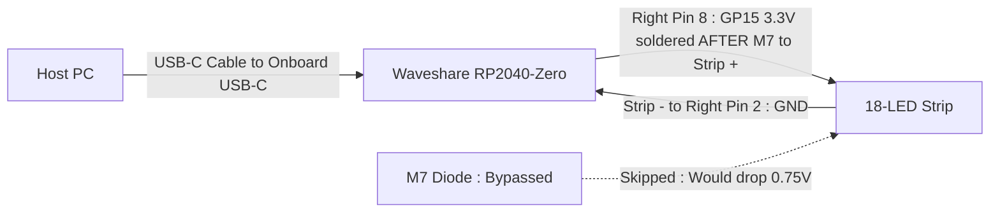

# USB-C Powered RP2040-Zero Direct 18-LED Strip Design (No LR7843 Driver)

> [!NOTE]
> This alternate circuit design document covers driving the **18-LED White Strip** (which has **6× $150\,\Omega$ resistors**—one every 3 LEDs—and a series **`M7` diode**) **directly from the Waveshare RP2040-Zero without the `LR7843 / D4184` MOSFET module**.
> For the original design using the `LR7843 / D4184` MOSFET driver, see [`USB_C_RP2040_LR7843_CIRCUIT_DESIGN.md`](file:///D:/Git/USBCommunicator/docs/USB_C_RP2040_LR7843_CIRCUIT_DESIGN.md).

---

## 1. Executive Summary & The Impact of the `M7` Diode

When skipping the `LR7843 / D4184` MOSFET module and driving the 18-LED strip directly from the **Waveshare RP2040-Zero**, the strip is powered by the RP2040's **$3.3\,\text{V}$ GPIO output** instead of the $5.0\,\text{V}$ USB rail.

### How the Series `M7` Diode Impacts a Direct $3.3\,\text{V}$ RP2040 Connection:

1. **Why the `M7` Diode Blocks $3.3\,\text{V}$ Operation if Left in Series**:
   - An **`M7` (`1N4007`) silicon diode** drops **$\sim 0.70\,\text{V}\text{–}0.80\,\text{V}$** when conducting.
   - A **White LED** requires at least **$\sim 2.85\,\text{V}\text{–}3.00\,\text{V}$** ($V_f$) to light up.
   - If you feed **$3.3\,\text{V}$** from an RP2040 GPIO pin into the `M7` diode, the voltage after the `M7` diode drops to:
     $$V_{\text{strip+}} = 3.30\,\text{V} - 0.75\,\text{V} = \mathbf{2.55\,\text{V}}$$
   - Because **$2.55\,\text{V}$ is below the $2.85\,\text{V}$ White LED turn-on threshold**, the LED strip **will not light up** (or will barely glow) if the $3.3\,\text{V}$ GPIO wire is connected *before* the `M7` diode.

2. **The Fix (Bypass the `M7` Diode)**:
   - The `M7` diode was only added to the strip to drop $0.8\,\text{V}$ when plugged directly into a $5.0\,\text{V}$ supply (and for reverse-polarity protection).
   - When driving the strip from a **$3.3\,\text{V}$ RP2040 GPIO pin**, **solder your GPIO wire *after* the `M7` diode** (directly to the strip's `+` pad on the cathode/band side of the `M7` diode, or remove/bridge the `M7` diode).
   - With the `M7` diode bypassed, the strip receives the full **$3.30\,\text{V}$** from the GPIO pin, leaving $3.30\,\text{V} - 2.90\,\text{V} = \mathbf{0.40\,\text{V}}$ across the six $150\,\Omega$ resistors ($R_{\text{eq}} = 25\,\Omega$), which safely lights all 18 LEDs at **$\sim 12\text{–}16\,\text{mA}$ total**!

---

## 2. Simple Block & Wiring Diagrams (No LR7843)

### 2.1 Direct Hookup Block Diagram (Bypassing the `M7` Diode)



### 2.2 Schematic Comparison: With vs. Without `M7` on a $3.3\,\text{V}$ GPIO Pin

```
❌ IF CONNECTED BEFORE M7 DIODE (WON'T LIGHT UP ON 3.3V):
RP2040 GP15 (3.30V) ---> [ M7 Diode (-0.75V) ] ---> 2.55V (Too low for 2.9V White LEDs!)

✅ IF CONNECTED AFTER M7 DIODE (WORKS ON 3.3V):
                                      +--- [150R] ---> [3x White LED] ---+
                                      |--- [150R] ---> [3x White LED] ---|
RP2040 GP15 (3.30V) ---> Strip + Bus -+---   ... (6 segments total)   ---+-+-> Strip (-) ---> RP2040 GND
(Bypass M7 Diode)                     |--- [150R] ---> [3x White LED] ---+
```

---

## 3. Electrical Math: 18-LED Strip Driven Directly by RP2040 ($3.3\,\text{V}$)

Your strip has **6 parallel segments**, each with a **$150\,\Omega$ (`151`) resistor** in series with **3 parallel White LEDs** ($18\text{ LEDs}$ total):

1. **Equivalent Strip Ballast Resistance ($R_{\text{eq}}$)**:
   $$R_{\text{eq}} = \frac{150\,\Omega}{6\text{ segments}} = 25.0\,\Omega$$

2. **Current With `M7` Diode Left in Series ($3.3\,\text{V}$ GPIO)**:
   - Required turn-on voltage: $V_{\text{min}} = V_{f(\text{M7})} + V_{f(\text{LED})} \approx 0.70\,\text{V} + 2.85\,\text{V} = 3.55\,\text{V}$
   - Available GPIO voltage: $3.30\,\text{V} < 3.55\,\text{V}$
   - **Result**: **$I_{\text{strip}} \approx 0\,\text{mA}$ (LEDs stay OFF)**.

3. **Current With `M7` Diode Bypassed ($3.3\,\text{V}$ GPIO Connected After `M7`)**:
   - Available voltage at strip `+` bus: **$3.25\text{–}3.30\,\text{V}$**
   - White LED forward voltage at low current ($\sim 0.8\,\text{mA}$/LED): **$V_{f(\text{LED})} \approx 2.90\,\text{V}$**
   - Voltage across the six $150\,\Omega$ resistors:
     $$V_R = 3.25\,\text{V} - 2.90\,\text{V} = 0.35\,\text{V}$$
   - **Total Strip Current**:
     $$I_{\text{strip}} = \frac{0.35\,\text{V}}{25\,\Omega} \approx \mathbf{14.0\,\text{mA}}\quad (\sim 2.3\,\text{mA}\text{ per 3-LED segment, or }\sim 0.8\,\text{mA}\text{ per LED})$$

> [!TIP]
> **Optional Brightness & Current Safety Boost (2 GPIO Pins in Parallel):**
> A single RP2040 GPIO pin has a nominal drive setting of **$12\,\text{mA}$** (`PAD_GPIO_DRIVE = 12mA`). Because the 18-LED strip wants $\sim 14\text{–}16\,\text{mA}$ at $3.3\,\text{V}$, you can either:
> - **Use 1 GPIO pin (`GP15`)**: The pin's internal CMOS output resistance ($\sim 25\text{–}30\,\Omega$) naturally self-limits the total current to **$\sim 8\text{–}10\,\text{mA}$**, which is safe for continuous operation at gentle indicator brightness.
> - **Tie 2 GPIO pins together (`GP14` + `GP15`)**: Switching both pins together doubles the safe current budget to **$24\,\text{mA}$** and reduces output voltage droop, giving noticeably brighter output across all 18 LEDs.

---

## 4. Bill of Materials & Shopping List (Direct RP2040 Setup)

| Item | Specification | Qty | Status | Notes |
|---|---|---|---|---|
| **1. Waveshare RP2040-Zero** | RP2040 USB-C Dev Board | **1** | **Owned** | Provides USB-C interface, $3.3\,\text{V}$ LDO, and GPIO drive |
| **2. 18-LED White Strip** | $6\times 150\,\Omega$ resistors + 18 LEDs | **1** | **Owned** | Bypass the series `M7` diode on the `+` input |
| **3. External Resistors / MOSFET** | None | **0** | **Not Needed ($0)** | Strip already has $6\times 150\,\Omega$ resistors built in |
| **4. Hookup Wire** | 22–24 AWG wire | **2 wires** (or 3 if using 2 GPIOs) | **Required** | Only `+` and `-` wires between RP2040-Zero and strip |
| **5. USB-C Data Cable** | USB-C data-capable cable | **1** | **Required** | Connects RP2040-Zero to Host PC |

---

## 5. Quick 2-Wire Assembly & MicroPython Guide

### 5.1 Wiring Table

| Wire # | From (RP2040-Zero) | To (18-LED Strip) | Important Detail |
|---|---|---|---|
| **Wire 1** | **`GP15`** *(and optionally **`GP14`** in parallel)* | **Strip `+` (Cathode/Band side of `M7` diode)** | **Solder *after* the `M7` diode** (bypassing `M7`) so the strip gets the full $3.3\,\text{V}$ |
| **Wire 2** | **`GND`** | **Strip `-`** | Ground return |

### 5.2 MicroPython Control Snippet ([`rp2040/code.py`](file:///D:/Git/USBCommunicator/rp2040/code.py))

```python
import machine

# Drive GP15 (and optionally GP14 if wired in parallel for higher current/brightness)
strip_pwm_15 = machine.PWM(machine.Pin(15))
strip_pwm_15.freq(1000)

# Turn 18-LED Strip ON (100% duty cycle)
strip_pwm_15.duty_u16(65535)

# Set 50% brightness
strip_pwm_15.duty_u16(32768)

# Turn 18-LED Strip OFF
strip_pwm_15.duty_u16(0)
```

---

## 6. Comparison: Direct RP2040 ($3.3\,\text{V}$) vs. With `LR7843` Module ($5.0\,\text{V}$)

| Feature | Direct RP2040-Zero (No `LR7843`) | With `LR7843 / D4184` Module |
|---|---|---|
| **Supply Voltage to Strip** | **$3.3\,\text{V}$** (from GPIO pin) | **$5.0\,\text{V}$** (from USB `VBUS` pin) |
| **What to do with `M7` Diode** | **Must bypass `M7`** (otherwise $3.3\,\text{V} - 0.75\,\text{V} = 2.55\,\text{V}$ won't turn LEDs on) | **Keep `M7` in series** ($5.0\,\text{V} - 0.78\,\text{V} = 4.22\,\text{V}$) |
| **Total Strip Current (18 LEDs)** | **~8–14 mA** (soft indicator glow) | **~50 mA** (full $5\,\text{V}$ brightness) |
| **Wires Required** | **2 wires** (`GP15` $\rightarrow$ Strip `+`, `GND` $\rightarrow$ Strip `-`) | **5 wires** (`GP15`, `5V`, `GND`, Strip `+`, Strip `-`) |
