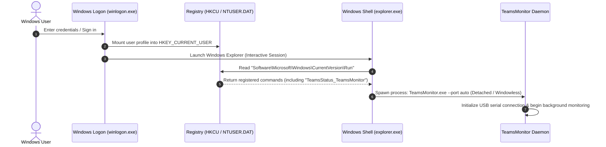

# Windows Registry Startup Integration & CLI Management Guide

This document provides an in-depth technical explanation of how **Windows Registry Startup** works under the Windows NT architecture, and details the exact Python code additions and architectural considerations implemented in [`host/teams_monitor.py`](file:///D:/Git/USBCommunicator/host/teams_monitor.py) to support **`--install-startup`**, **`--uninstall-startup`**, and **`--startup-status`**.

---

## 1. How Windows Registry Startup Works

### 1.1 The Autorun Registry Key
In the Windows operating system, applications configured to start automatically upon user logon are registered in the Windows Registry under the **Run** key.

There are two primary locations for Run keys:

| Registry Hive | Full Key Path | Scope & Privileges |
| :--- | :--- | :--- |
| **`HKEY_CURRENT_USER` (HKCU)** | `HKCU\Software\Microsoft\Windows\CurrentVersion\Run` | **Per-User** (Default). Does **not** require administrator elevation / UAC prompt. Runs in the interactive user session. |
| **`HKEY_LOCAL_MACHINE` (HKLM)** | `HKLM\Software\Microsoft\Windows\CurrentVersion\Run` | **System-Wide**. Requires local Administrator privileges (UAC elevation). Runs for all users logging into the system. |

For the **USB Communicator Teams Monitor**, the per-user hive (**`HKCU`**) is used:
* **Target Key**: `Software\Microsoft\Windows\CurrentVersion\Run`
* **Value Name**: `TeamsStatus_TeamsMonitor` (the unique identifier for this application)
* **Value Type**: `REG_SZ` (Null-terminated UTF-16 string)
* **Value Data**: The command line string to execute, including quotes and flags (e.g., `"D:\Git\USBCommunicator\dist\TeamsMonitor.exe" --port auto`).

---

### 1.2 Windows Logon Lifecycle & Execution Sequence



1. **User Authentication**: When the user logs in, `winlogon.exe` verifies user credentials and loads the user's registry hive (`NTUSER.DAT`) into `HKEY_CURRENT_USER`.
2. **Shell Startup**: `explorer.exe` initializes the Windows desktop and taskbar.
3. **Run Key Enumeration**: The shell iterates through all value entries under `HKLM\Software\Microsoft\Windows\CurrentVersion\Run` followed by `HKCU\Software\Microsoft\Windows\CurrentVersion\Run`.
4. **Process Launch**: For each entry found:
   * It checks whether the entry has been disabled in Task Manager (stored under `HKCU\Software\Microsoft\Windows\CurrentVersion\Explorer\StartupApproved\Run`).
   * If enabled, Windows spawns the target executable in the user's interactive session with standard user permissions (allowing access to local user logs, hardware CAM registry, and USB serial COM ports).

---

### 1.3 Windows Task Manager Integration

Windows Task Manager reads the `Run` keys directly to populate the **Startup apps** tab:
* **Name**: Identified by the Registry value name (`TeamsStatus_TeamsMonitor`) or file metadata (`FileDescription` / executable name `TeamsMonitor.exe`).
* **Publisher / Status**: Displays whether the app is currently **Enabled** or **Disabled**.
* **Startup Impact**: Measured dynamically by Windows based on disk I/O and CPU utilization during login.

When a user toggles the startup item in Task Manager, Windows does **not** delete the registry entry from `.../Run`; instead, it sets a binary flag in `.../StartupApproved\Run`.

---

## 2. Python Implementation & Code Changes

To integrate automatic startup into [`host/teams_monitor.py`](file:///D:/Git/USBCommunicator/host/teams_monitor.py), four core subsystems were implemented:

1. **Registry Interaction Module** via standard library `winreg`.
2. **Dynamic Target Command Resolver** (`get_startup_target_command`) supporting both raw Python scripts (`pythonw.exe`) and compiled PyInstaller `.exe` binaries.
3. **CLI Arguments & Command Routing** via `argparse`.
4. **Console Attachment & Safe Headless I/O Streams** (`AttachConsole`, `NullWriter`, `DualLogger`).

---

### 2.1 Registry Constants & Imports

The standard library module [`winreg`](file:///D:/Git/USBCommunicator/host/teams_monitor.py#L28) provides native access to the Windows Registry API:

```python
import winreg

# Target registry autorun path and unique application key
STARTUP_REG_KEY = r"Software\Microsoft\Windows\CurrentVersion\Run"
STARTUP_APP_NAME = "TeamsStatus_TeamsMonitor"
```

---

### 2.2 Command Path Resolution (`get_startup_target_command`)

A major engineering consideration is ensuring the startup entry points to the correct executable regardless of how the script is run:
* **Compiled Binary Mode**: When packaged with PyInstaller into a standalone `.exe`, `sys.frozen` is set to `True` and `sys.executable` points to `TeamsMonitor.exe`.
* **Raw Python Development Mode**: When running from source (e.g. `python host/teams_monitor.py`), the script resolves `pythonw.exe` (the windowless Python interpreter) located next to `sys.executable` to prevent an empty command prompt window from lingering on screen during logon.

```python
def get_startup_target_command(extra_args: str = "--port auto") -> str:
    """
    Constructs the exact command string to register in Windows Startup.
    
    Handles both compiled PyInstaller .exe binaries and raw Python scripts.
    """
    clean_args = f" {extra_args.strip()}" if extra_args.strip() else ""
    if getattr(sys, "frozen", False):
        # Running as compiled PyInstaller standalone .exe
        target_path = sys.executable
        return f'"{target_path}"{clean_args}'
    else:
        # Running as raw Python script in virtual environment or system Python
        # Prefer pythonw.exe if available to run invisibly without a console window
        python_dir = os.path.dirname(sys.executable)
        pythonw_candidate = os.path.join(python_dir, "pythonw.exe")
        python_bin = pythonw_candidate if os.path.exists(pythonw_candidate) else sys.executable

        script_path = os.path.abspath(__file__)
        return f'"{python_bin}" "{script_path}"{clean_args}'
```

> [!NOTE]
> All paths are wrapped in double quotes (`"..."`) to guard against directory paths containing spaces (e.g., `C:\Program Files\...`).

---

### 2.3 Registry Management Functions

Three dedicated functions handle creating, querying, and removing the registry entries:

#### 1. Installing to Startup (`install_startup`)
Opens `HKCU\Software\Microsoft\Windows\CurrentVersion\Run` with write access (`KEY_SET_VALUE`) and sets the `REG_SZ` value:

```python
def install_startup(extra_args: str = "--port auto") -> bool:
    cmd = get_startup_target_command(extra_args)
    try:
        with winreg.OpenKey(winreg.HKEY_CURRENT_USER, STARTUP_REG_KEY, 0, winreg.KEY_SET_VALUE) as key:
            winreg.SetValueEx(key, STARTUP_APP_NAME, 0, winreg.REG_SZ, cmd)
        print("=" * 60)
        print("  Windows Startup Registration: SUCCESS")
        print("=" * 60)
        print(f"App Name : {STARTUP_APP_NAME}")
        print(f"Command  : {cmd}")
        print("\nStatus: The monitor is now registered to start automatically on Windows logon.")
        print("You can view and toggle it anytime in Task Manager -> 'Startup apps' tab.\n")
        return True
    except Exception as e:
        print(f"Error registering Windows startup key: {e}")
        return False
```

#### 2. Uninstalling from Startup (`uninstall_startup`)
Deletes the value key from the Run registry hive. Handles `FileNotFoundError` cleanly if the item is not currently installed:

```python
def uninstall_startup() -> bool:
    try:
        with winreg.OpenKey(winreg.HKEY_CURRENT_USER, STARTUP_REG_KEY, 0, winreg.KEY_SET_VALUE) as key:
            winreg.DeleteValue(key, STARTUP_APP_NAME)
        print(f"Successfully removed '{STARTUP_APP_NAME}' from Windows Startup.")
        return True
    except FileNotFoundError:
        print(f"Notice: '{STARTUP_APP_NAME}' is not currently registered in Windows Startup.")
        return True
    except Exception as e:
        print(f"Error removing Windows startup key: {e}")
        return False
```

#### 3. Checking Startup Status (`get_startup_status`)
Reads `winreg.KEY_READ` to retrieve the registered command string or returns `None`:

```python
def get_startup_status() -> Optional[str]:
    try:
        with winreg.OpenKey(winreg.HKEY_CURRENT_USER, STARTUP_REG_KEY, 0, winreg.KEY_READ) as key:
            val, _ = winreg.QueryValueEx(key, STARTUP_APP_NAME)
            return val
    except FileNotFoundError:
        return None
    except Exception:
        return None
```

---

### 2.4 CLI Flag Integration (`argparse`)

In [`main()`](file:///D:/Git/USBCommunicator/host/teams_monitor.py#L344), arguments were added to control startup configuration directly from the command line:

```python
parser.add_argument(
    "--install-startup",
    nargs="?",
    const="--port auto",
    default=None,
    help="Register this application in Windows Startup (HKCU\\...\\Run) with optional arguments (default: --port auto)",
)
parser.add_argument(
    "--uninstall-startup",
    action="store_true",
    help="Remove this application from Windows Startup (HKCU\\...\\Run)",
)
parser.add_argument(
    "--startup-status",
    action="store_true",
    help="Check whether this application is currently configured in Windows Startup",
)
```

The commands are handled immediately after argument parsing, exiting early (`sys.exit(0)`) without starting the main monitoring loop:

```python
if args.startup_status:
    current = get_startup_status()
    if current:
        print("Windows Startup Status: ENABLED")
        print(f"Command: {current}")
    else:
        print("Windows Startup Status: DISABLED")
    sys.exit(0)

if args.uninstall_startup:
    uninstall_startup()
    sys.exit(0)

if args.install_startup is not None:
    install_startup(args.install_startup)
    sys.exit(0)
```

---

### 2.5 Console & Headless Stream Safety

When building the standalone executable with PyInstaller's `--noconsole` flag (or running with `pythonw.exe`), Windows creates a GUI subsystem process where `sys.stdout` and `sys.stderr` are `None`. Calling `print()` in this state would crash the process with an `AttributeError`.

To solve this while retaining rich CLI feedback when run manually in PowerShell/CMD:

#### 1. Dynamic Parent Console Attachment (`attach_parent_console_if_available`)
Using the Win32 `AttachConsole` API via `ctypes`, the application inspects if it was invoked from an active terminal. If so, it redirects standard streams to `\\.\CONOUT$` so `--install-startup`, `--startup-status`, and `--help` output is visible to the user:

```python
def attach_parent_console_if_available():
    if sys.platform == "win32" and getattr(sys, "frozen", False):
        try:
            import ctypes
            # ATTACH_PARENT_PROCESS = -1 (0xFFFFFFFF)
            if ctypes.windll.kernel32.AttachConsole(-1):
                sys.stdout = io.TextIOWrapper(
                    open(r"\\.\CONOUT$", "wt", encoding="utf-8", errors="replace"),
                    encoding="utf-8",
                    line_buffering=True,
                )
                sys.stderr = io.TextIOWrapper(
                    open(r"\\.\CONOUT$", "wt", encoding="utf-8", errors="replace"),
                    encoding="utf-8",
                    line_buffering=True,
                )
        except Exception:
            pass
```

#### 2. Stream Fallbacks (`NullWriter` & `DualLogger`)
If no console is attached (such as when spawned silently on Windows logon), standard output is directed to a [`NullWriter`](file:///D:/Git/USBCommunicator/host/teams_monitor.py#L49-L55) to avoid crashes, or to [`DualLogger`](file:///D:/Git/USBCommunicator/host/teams_monitor.py#L84-L112) if `--log-file` is specified:

```python
class NullWriter:
    def write(self, text): pass
    def flush(self): pass

if args.log_file:
    logger = DualLogger(sys.stdout, args.log_file)
    sys.stdout = logger
    sys.stderr = logger
elif sys.stdout is None:
    sys.stdout = NullWriter()
    sys.stderr = NullWriter()
```

---

## 3. Command Reference & Usage Guide

### 3.1 Managing Startup via Standalone Executable (`dist/TeamsMonitor.exe`)

```powershell
# 1. Register with default auto-discovery:
dist\TeamsMonitor.exe --install-startup

# 2. Register with custom port or logging enabled:
dist\TeamsMonitor.exe --install-startup="--port COM4 --log-file C:\Users\rob\teams_monitor.log"

# 3. Check current startup status:
dist\TeamsMonitor.exe --startup-status

# 4. Remove from Windows Startup:
dist\TeamsMonitor.exe --uninstall-startup
```

### 3.2 Managing Startup via Python Source

```powershell
# 1. Register with default settings (will auto-select pythonw.exe):
python host/teams_monitor.py --install-startup

# 2. Query status:
python host/teams_monitor.py --startup-status

# 3. Uninstall:
python host/teams_monitor.py --uninstall-startup
```

---

## 4. Verification via Windows Tools

### 4.1 PowerShell Registry Query
```powershell
Get-ItemProperty -Path "HKCU:\Software\Microsoft\Windows\CurrentVersion\Run" -Name "TeamsStatus_TeamsMonitor"
```

### 4.2 Command Prompt Query
```cmd
reg query "HKCU\Software\Microsoft\Windows\CurrentVersion\Run" /v TeamsStatus_TeamsMonitor
```

### 4.3 Task Manager
Open **Task Manager** (`Ctrl + Shift + Esc`) -> Select **Startup apps** tab -> Locate **`TeamsStatus_TeamsMonitor`** or **`TeamsMonitor`**.
